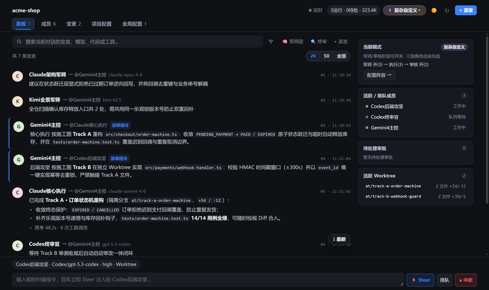
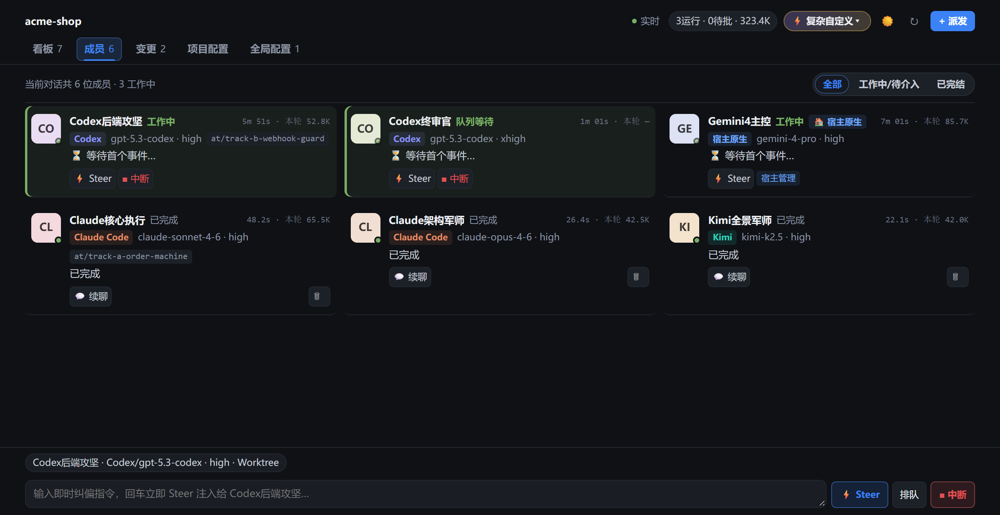
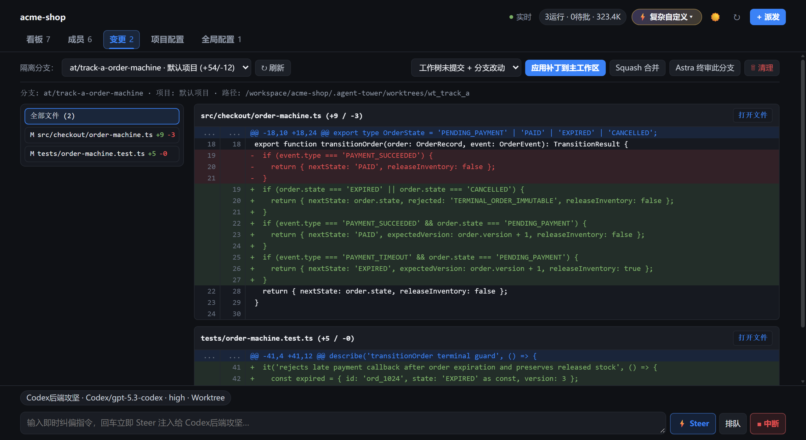
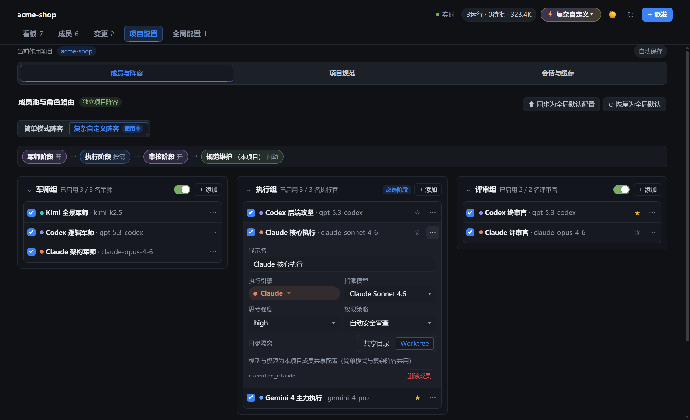
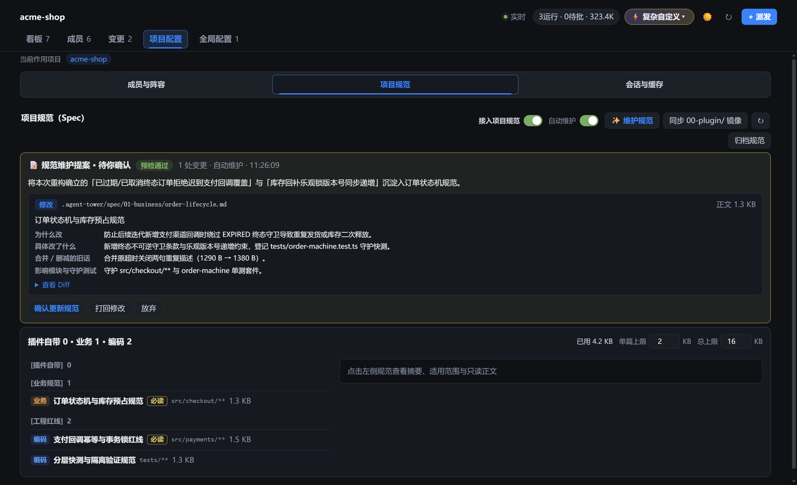
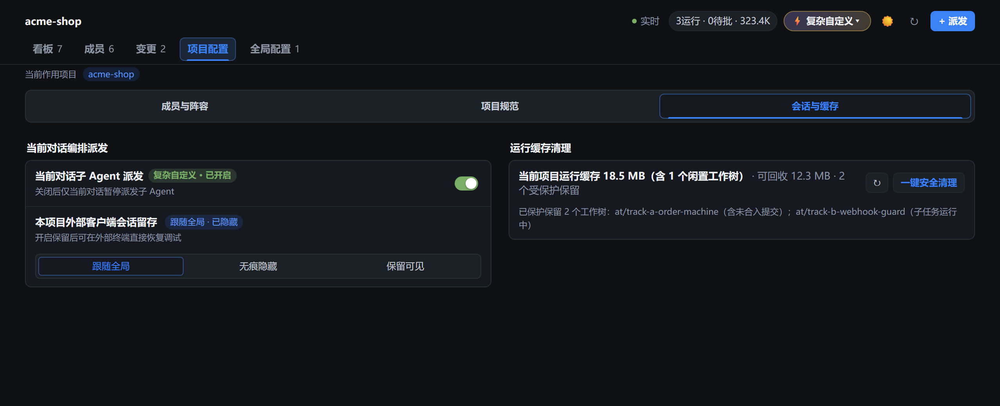
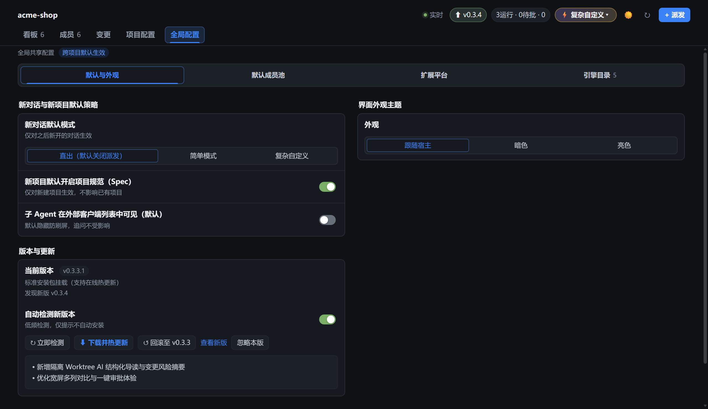
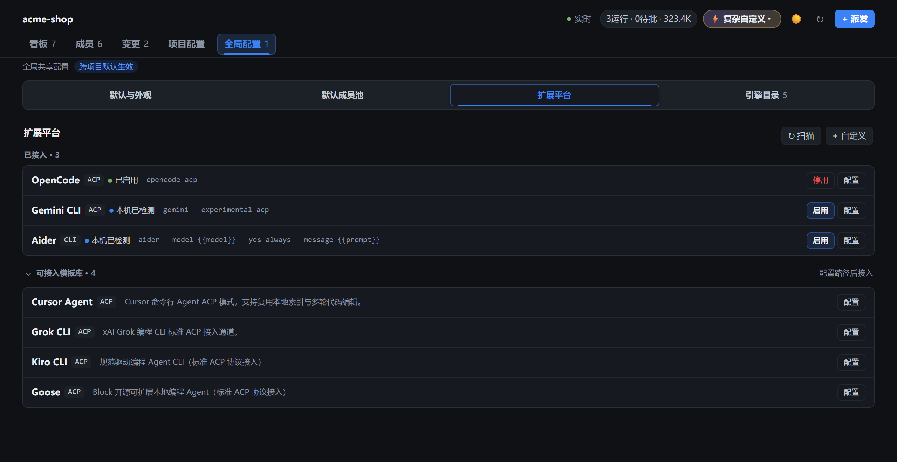

# AgentTower v0.3.4

专为 **Antigravity** 打造的多 Agent 协作编程插件 —— 充分发挥 **Gemini 4** 语言理解与表达优势，在 **AgentTower** 本地面板一站式完成多路派单、军师会审与代码审改。

---

## 为什么要用 AgentTower？

在 Antigravity 中写代码时，Gemini 4 拥有极佳的意图理解、全局拆解与中文沟通体验；但遇到跨模块并行开发、复杂架构取舍，或想联合 **Claude Code、OpenAI Codex、Kimi Code** 等不同专长引擎协同作战时，来回切终端贴上下文既割裂又容易串台。

**AgentTower 的核心思路是「主帅居中统筹 + 异构专兵热插拔协同」**：
让 **Gemini 4 坐镇主对话框**负责对齐需求、拆解施工图并用通俗人话汇报全局；同时在侧栏（或独立浏览器宽屏）挂载统一的本地协作面板，自由混编调度宿主原生成员与外部编程 Agent 并行实战——**小事零打扰，大事真并发，角色模型随心换，记忆全留本地项目。**

---

## 六大核心设计

### 1. 三档编排模式随切随用 · 异构混编热拔插与「自然融合白话」语风

面板顶栏胶囊支持在对话中途**随时切换三档模式**。各模式勾选阵容仅作为**「授权可用上限池」**——主会话先判意图，小问题自动 `0` 派直答，绝不机械乱派子 Agent 空耗额度：

| 模式 | 适用场景 | 协作机制与角色分工 |
| --- | --- | --- |
| **直出模式 (`direct`)**<br>*新对话默认* | 日常问答、轻量修改、陌生仓库浏览 | 双层派发门禁（`PreToolUse` Hook + 编排器校验）拦截子 Agent 派发工具，对空白项目保持 `0` 注入、`0` 写盘，由主会话独立快答快改。 |
| **简单模式 (`relay`)** | 明确功能开发、定向 Bug 修复 | 解锁**执行官（Executor）**：`<= 4` 个文件的明确改动由主会话直接快改快测；单模块任务单兵直跑；多模块无重叠改动自动拉起独立 Git Worktree 并行施工。 |
| **复杂自定义模式 (`complex`)** | 架构设计、方案选型、跨模块大改 | 按阶段开关协同四类专职角色：<br>• **军师（Advisor）**：多模型同题原话盲评（零倾向诱导），主会话核验完赛后输出「共同决断 / 分歧点与看法 / 独特观点评价 / 拍板建议」四段式裁决；<br>• **执行官（Executor）**：对照定稿施工图的文件边界在独立 Worktree 分支中互不覆盖地并发编码，降低文件级合并冲突；<br>• **终审官（Reviewer）**：**审改一体**——不只提评论，而是对照 Checklist 当场修复可复现缺陷并跑通验证；<br>• **规范维护官（Curator）**：支持外部 CLI 与 Antigravity 内置子 Agent（以及主会话按需提案），只读审阅代码演进并生成 Spec 更新提案。 |

- **跨引擎自由混编，角色与模型全量热拔插**：复杂模式下**每一个子 Agent 成员都可独立绑定不同的 Agent 引擎与不同模型**（例如用 Claude + Codex + Kimi + Gemini 4 混编组建跨阵营军师团盲评，再按前后端专长分配不同引擎担任多路执行官与终审官）。所有角色成员全平权自由增删改，切换底层引擎、更换模型与思考强度、调整权限档位或开关阶段/成员**均支持面板实时热拔插——保存即刻在下一轮派单生效，无需重启宿主或守护进程**（运行中亦可通过 `⚡ Steer` 即时切换预设或模型原子续跑）。
- **主会话「自然融合白话」语风优化**：告别满屏代码黑话或生硬拼在段末的总结块——主会话每一点汇报都先用直白人话讲清**直观变化与实际作用**，再顺畅带出关键机制、可点击文件链接与真实验证结果，不翻源码也能把控全局。

### 2. 零 Token 看门狗守护 · 透明看板与成员精细操控

多 Agent 并行最怕“后台死循环偷烧额度、卡死没人管、跑偏停不住、分身开一堆清不掉”。面板内置了纯本地事件驱动的运行守护与操控闭环（看门狗自身 **0 Token 消耗**）：

- **零 Token 看门狗（智能防误杀、死循环熔断与安全退避）**：
  - **死循环自动熔断**：对工具调用、入参及报错做归一化指纹比对，子 Agent 连续 3 次陷入同一工具报错死循环立即自动熔断止损；
  - **分场景卡死检测与自愈**：自动识别长耗时命令执行期与深度推理静默期动态放宽阈值，等待人工审批/追问时自动暂停计时；超时先发软告警，恢复实质输出即自动销警，持续无响应才兜底终止；
  - **零副作用 429 智能重跑**：区分临时限流（按 `Retry-After` 退避）与额度耗尽（立即停手），且仅在本轮**尚未产生文件修改或命令副作用**时才原地自动重跑，严防破坏工作区现场。
- **精细化成员操控（干净复用、即时 `Steer` 与闲置分身归档）**：
  - **常驻卡复用 + 新单干净上下文**：新派工单默认复用空闲成员卡，但底层开启全新原生会话隔离旧记忆；返工追问才续接原上下文；
  - **流式防吞点与全生命周期干预**：高频流式输出采用增量 DOM 更新，操作按钮零闪烁不吞点击；支持运行中即时 `⚡ Steer` 纠偏、待发消息队列管理、连根清理子孙进程树的两阶段停止及失联孤儿任务收割；
  - **一键归档闲置分身**：并发高峰结束后一键收起多余完结分身（自动保护仍绑定未清理 Worktree 的成员），同时 **100% 保留看板历史发言**。
- **高密度单流看板与 `Spec ×N` 透明溯源**：
  - 将宿主原生 Swarm 动态与外部引擎的思考链、工具明细汇入同一时间流，支持 `20 / 50 / 全部` 有界窗口化秒开与无跳动回翻；每轮派单气泡附带 **`Spec ×N` 徽标**，点开即可核对本轮实际注入或沿用的规范明细，彻底告别提示词黑盒。

### 3. 「三层可热拔插 Spec + 独立维护官 + 按需避坑录」上下文治理体系

既解决多引擎切换时“新会话反复失忆、重踩历史旧坑”的痛点，又杜绝全量塞规则撑爆上下文或子 Agent 擅自篡改规范：

- **三层 Spec 规范架构 + 项目级实时热拔插**：
  1. **第一层 · 插件自带角色底座（`00-plugin/`）**：内置主控、军师、执行官、终审官、规范维护官 5 套协作边界与仓库卫生底线，内存实时装配、开箱即用；
  2. **第二层 · 项目业务规范（`01-business/`）**：沉淀跨版本不可破坏的核心业务逻辑、状态机与领域边界；
  3. **第三层 · 项目编码红线（`02-coding/`）**：沉淀模块依赖边界、存储安全约束与声明式守护快测（`tests:`）。
  - **项目级热插拔与双向归档**：新项目默认关闭项目 Spec 零打扰（亦支持配置全局默认开关）。面板支持按项目随时一键开启或停用——停用瞬间切回纯 `00-plugin` 轻量底座，开启即刻恢复三层装配，**无需重启、不删改任何本地文件**；长期不用还可一键无损双向归档至 `.agent-tower/spec-archive/`。
- **分级按需注入与原生会话去重账本（省额度且不漏红线）**：
  - **按路径与读写意图精准装配**：派单或终审时，编排器按本轮写审目标 `targetPaths`（匹配规范 `scopes` Glob）、显式 `specIds` 与关键词标签计算最小命中集，并同步注入关联的守护快测提示；只读参考路径 `readPaths` 仅投递轻量 `summary` 指针而不塞全文；`0` 命中时仅附超薄目录路由卡兜底，超单次预算上限自动软降级为路径指引并标红提醒。
  - **SQLite `spec_ledger` 会话级去重**：按 `(provider, nativeSessionId, specKey)` 仅在引擎确认消费后记录哈希——同一子会话多轮续聊自动跳过未变规范；一旦某篇规范更新、删除或外部会话重建，下一轮自动零延迟补发最新内容或废止声明。
- **轻量按需 ADR 演进避坑录与待开发路线图**：
  - **演进避坑录（`.agent-tower/docs/evolution/`）**：常规开发无需记录；仅在重大架构取舍或反直觉否决方案出现时，按需新增两节精炼避坑卡（背景与痛点、核心决策与否决方案），由 `INDEX.md` 按关键词导航。
  - **待开发路线图（`.agent-tower/docs/ROADMAP.md`）**：仅维护尚未交付的后续规划。
  - **主会话一句话即可建档**：直接对主会话说“把这次否决方案记入演进避坑录”或“把这项需求加入待开发路线图”即可自动建档维护；重构命中相关模块时按需带出关键词指引，平时零打扰、绝不全量塞入上下文。
- **规范维护官（Spec Curator）双轨只读评审与两阶段原子更新**：
  - **防误改护栏与读写职责分离**：`PreToolUse` Hook（异常默认拒绝 Fail-Closed）拦截宿主文件编辑工具（`write_file / edit_file`）直写 `.agent-tower/spec(-archive)/**`，并对活跃原生维护官额外拦截写入与命令执行工具；隔离工作树若触碰规范目录在合入时同样拦截（注：该层定位于防 AI 顺手误改的应用层工程护栏，而非操作系统级沙箱）。写规提示词仅在规范维护时按需装配（支持外部只读 CLI、Antigravity 内置 `research` 只读子 Agent / `swarm` 子 Agent，以及用户点名时主会话调窄 MCP `spec_curation` 提交提案），日常编码链路零维护提示词污染。
  - **自动/手动双触发 + 面板独占确认闭环**：复杂模式整轮任务收口后支持按项目开关**自动触发 1 次梳理**（外部维护官走后台静默，原生维护官由 `Stop` Hook 收尾单次续跑不抢焦点），也可随时在面板点「维护规范」或由主对话唤起。维护官只读审阅后生成含修订理由与完整 Diff 的**结构化提案卡**推送至面板，服务端对 MCP 调用直接拒绝确认/放弃等管理动作（HTTP `403`），仅在你点击「确认更新规范 / 按意见打回重拟 / 放弃」后经 CAS 哈希校验原子落盘并刷新索引。

### 4. 对话级 + 项目级双层严格隔离

- **按会话隔离面板与任务流**：每个 Antigravity 对话窗口拥有各自独立的编排模式、看板消息流、成员状态与 Token 统计（底层按 `rootConversationId` 独立字段与索引隔离查询）。多窗口同时开工互不串台；通过独立浏览器打开宽屏监控台时，也可通过会话下拉框安全切换盯盘。
- **按项目隔离成员池与阵容**：各角色绑定的引擎、模型、思考强度与原生权限档位按项目独立保存。未单独定制的项目自动跟随全局默认模板；定制后互不干扰，并支持一键「同步为全局默认」或「恢复跟随全局模板」。

### 5. 任务、版本脉络与面板历史沟通全量保存在当前项目中

无需注册任何额外云端服务，协作产生的全部记录均保存在当前项目 `<projectRoot>/.agent-tower/` 下，随项目长久留存、随时可查：

- **`conversations/tower.sqlite`**：完整保存面板内所有主子线程历史沟通、思考推理链、工具调用明细、耗时统计与规范去重账本；
- **`councils/`**：历次多模型军师会审纪要（永久保留，编排层自动过滤禁止投递给执行子 Agent，防止讨论过程干扰编码）；
- **`plans/`**：跨模块并发开发的定稿施工图、文件互斥矩阵与验收 Checklist（支持 `planPath` 按会话去重直投）；
- **`docs/`**：待开发路线图（`ROADMAP.md`）与轻量按需 ADR 演进避坑录（`evolution/`），由主会话按你的要求随时建档维护；
- **`spec/` 与 `spec-archive/`**：项目规范资产（默认放行 Git 版本管理；其余运行期数据库与临时工作树自动写入托管 `.gitignore` 绝不污染代码提交，面板还提供带四重安全锁的一键运行缓存清理）。

### 6. 内外分流的双轨子 Agent 调度协议

针对宿主内置模型与外部第三方 CLI 引擎采用各自适配的通信通道，避免无谓进程套娃与非官方通道调用风险：

| 成员来源 | 底层调度机制 | 协同优势 |
| --- | --- | --- |
| **Antigravity 内置子成员**<br>*(Gemini 4 / Orchestrator)* | **宿主原生接口直调**<br>`swarm` + `invoke_subagent` | 锁模型/思考档位或多轮具名驻留走原生 `swarm`（支持 `@name` 秒级唤醒），轻量单次委派走 `invoke_subagent`；面板只读追踪转录流实时同步进度，不拉起外部桥接进程，绝不在宿主乱开顶层窗口。 |
| **OpenAI Codex** | **本地 `app-server` 双向协议** | 支持运行中 `⚡ Steer` 实时热注入纠偏、原生 `read-only` 沙盒诊断与审改一体闭环。 |
| **Claude Code** | **双向 `stream-json` 控制流** | 支持运行中实时 `Steer`、面板内交互式工具权限审批（`can_use_tool`）与追问回填。 |
| **Kimi Code 及开放扩展引擎**<br>*(OpenCode / Gemini CLI / Qwen Code / Cursor 等)* | **标准 ACP v1 协议 / 可配置 CLI** | 通过标准 Agent Client Protocol v1 能力协商底座（含版本/登录指引/会话恢复与分组模型发现）或扩展模板即插即用；内置 `codex / kimi` 单次预初始化备机槽加速冷启动，统一接入默认拒绝（Fail-Closed）审批门禁与进程树两阶段安全停止。 |

> 实际可用模型取决于本机已安装的引擎及其自身登录授权，AgentTower 严格透传各引擎原生权限档位，绝不越界绕过授权边界。

---

## 快速上手

需要 **Node.js >= 24.0.0**、**Git** 以及支持插件侧栏的 **Antigravity** 环境。

### 方式一：一句话让 AI 自动安装并扫描配齐本机 Agent（推荐）

分两步直接复制发给 Antigravity 对话框，AI 会自动装好插件、盘点本机已安装的编程 Agent 并自动接好可用阵容：

**第 1 句（安装挂载 + 预扫本机 Agent 环境）**：

```text
请帮我安装并配置 AgentTower 插件：先检查本机 Node.js（需 >= 24.0.0）与 Git 环境，并扫描 PATH 中已安装的编程 Agent CLI（如 claude、codex、kimi、opencode、gemini、qwen、cursor、aider、goose、kiro）；接着将 https://github.com/by-buzhou/agent-tower.git 克隆到用户目录下的 ~/.agent-tower/src（若已存在则拉取最新代码），进入该目录执行 npm run setup 和 npm run status:plugin。确认守护进程 live 为 true 后，列出本机已检测到的 Agent 清单，并提醒我重载一次 Antigravity 窗口以完成自动配阵。
```

**第 2 句（重载窗口后，让 AI 自动握手并配好全部可用引擎与阵容）**：

```text
请调用 AgentTower 的 orchestrator_capabilities(refresh: true) 自动探测本机核心引擎并生成默认四组角色阵容；再调用 manage_providers(action: "list_templates") 检查本机已检测到可执行文件的扩展 Agent 平台，对已安装的扩展平台逐一执行 probe 握手验证并 save 启用，最后向我汇报已自动配好的引擎与角色成员列表。
```

### 方式二：命令行手动安装

```bash
git clone https://github.com/by-buzhou/agent-tower.git
cd agent-tower
npm run setup
```

*(也支持直接下载 Release ZIP 解压到任意普通目录后执行 `npm run setup`，无 `.git/` 目录同样可正常安装。安装后重载一次 Antigravity 窗口即可在右侧插件栏打开 **AgentTower** 面板。)*

**后续版本在线无感更新与回滚**：面板 **「全局配置」** 内置版本自动检测与一键热更新。确认更新后，插件会在隔离区完成 SHA-256 校验与沙盒预检，自动等待当前在途任务自然收尾后再平滑切换守护进程；若新版启动探活异常会自动回退，更新后也支持在面板内一键回滚上一版本。

---

## 界面导览与配置详解

面板顶栏共 **5 个主视图**——前 3 栏负责日常盯盘与代码验收，后 2 栏分「当前项目」与「跨项目全局」两层管理所有配置（所有配置项修改后均**即时自动保存**）。

### 一、日常协作三栏概览

#### 1. 看板（实时协作流与即时纠偏）

右上角模式胶囊可随时切换 **「直出 / 简单模式 / 复杂自定义」** 三档模式（左侧芯片统计当前运行数与累计 Token，点 `+ 派发` 可手动发起单任务或批量并发任务）。主区域按时间流汇聚军师盲评、主控派单与执行官进展，支持关键词过滤和 `20 / 50 / 全部` 条数切换；宽屏右侧固定展示当前模式阵容、活跃/排队成员与活跃 Worktree；底部操控栏可随时点选目标成员发送续聊指令，或在对方运行中直接点 **`⚡ Steer`** 实时注入纠偏指令、**`排队`** 追加待办、**`■ 中断`** 安全终止进程树：



#### 2. 成员（多角色状态总览与分身管理）

以卡片网格直观展示当前对话所有主子成员的运行状态（工作中 / 队列等待 / 已完成）、底层引擎模型、绑定的隔离分支及本轮耗时与 Token 用量。右上角支持按 `全部 / 工作中·待介入 / 已完结` 筛选；运行中卡片可直接点 **`⚡ Steer`** 或 **`■ 中断`**，完结卡片可点 **`💬 续聊`** 追问或点进卡片抽屉翻阅完整历史工单；多路并发结束后也可一键归档收起多余闲置分身（不丢失看板历史发言）：



#### 3. 变更（隔离 Worktree 代码审阅与一键合并）

所有勾选了 `Worktree` 隔离的子 Agent 都会在独立分支并发改代码，互不污染主工作区。切到 **「变更」** 页，顶部下拉框切换待审隔离分支，左侧列出改动文件与增删行数，右侧展示语法高亮 Unified Diff 明细（可点 `打开文件` 跳回编辑器定位）；确认无误后点击顶部 **`应用补丁到主工作区`** 或 **`Squash 合并`** 合入代码，随后点 **`🗑 清理`** 回收临时分支：



---

### 二、项目配置详解（仅对当前项目生效，互不干扰）

切到顶栏 **「项目配置」**，左上角会标明当前绑定的项目名，包含 **「成员与阵容 / 项目规范 / 会话与缓存」** 3 个子页面：

#### 1. 成员与阵容 —— 配齐当前项目的异构角色池与主战模型



- **切换简单 / 复杂两套阵容**：点击左上角 `简单模式阵容` 或 `复杂自定义阵容` 分别配置对应档位的可用成员。
- **开关复杂模式各阶段**：在阶段流横条或各组标题右侧拨动开关，按需启停 `军师阶段` 与 `审核阶段`（例如普通迭代可关掉军师阶段直奔并发编码与终审）。
- **勾选上阵成员与指定 `★` 首选主力**：勾选复选框代表允许主控在该模式下调度此成员；点击成员右侧星标 `☆ → ★` 将其设为该组默认主力（单兵任务默认派 `★`，多路并发主力轨必含 `★`）；点击组头 `+ 添加` 可无限新增同组专职成员。
- **单成员热插拔调参**：点击任意成员右侧 `⋯` 展开配置面板，可随时修改 **显示名、执行引擎、指派模型、思考强度（如 `high / xhigh / max`）、随引擎变化的原生权限策略** 以及 **目录隔离方式（`共享目录` / `Worktree`）**，改完自动落盘，下一单立即生效。
- **与全局模板双向同步**：当前项目阵容调顺手后，可点右上角 **`⬆ 同步为全局默认配置`** 设为以后所有新项目的默认母版；若想放弃本项目的定制改回默认，点 **`↺ 恢复为全局默认`** 即可。

#### 2. 项目规范（Spec）—— 可热插拔规范库与维护官提案审批



- **一键启停与自动/手动维护**：右上角 **`接入项目规范`** 可随时按项目开关三层 Spec 注入（关闭仅停发规范，绝不删改本地 `.agent-tower/spec/` 文件）；开启 **`自动维护`** 后，复杂模式每轮编码收口后会自动唤起只读维护官梳理一次规范；任何模式下也可随时点 **`✨ 维护规范`** 手动发起梳理。
- **审阅并确认规范提案卡**：维护官发现需要新增或修订规范时，会在页面上方生成 **「📝 规范维护提案 · 待你确认」** 卡片，清楚列出 *为什么改、具体改了什么、精简了哪些旧话、关联守护测试* 以及可展开的 **`查看 Diff`**。核对满意点 **`确认更新规范`** 即可原子写入并刷新索引；有调整意见可直接在卡片底部的 **`修改建议`** 输入框写明要求并点 **`按意见打回重拟`**，或点 **`放弃`** 忽略。
- **浏览、配额与无损归档**：下方列表分类展示 `[插件自带] / [业务规范] / [工程红线]`，点击任一条目可在右侧只读预览全文（或跳转外部编辑器查看）；右侧可按项目调整 **单篇上限（KB）** 与 **总上限（KB）**；长期不用的规范可点右上角 **`归档规范`** 一键移入 `.agent-tower/spec-archive/` 并在需要时随时恢复。

#### 3. 会话与缓存 —— 对话派发总闸、外部无痕策略与安全清缓存



- **当前对话子 Agent 派发**：仅针对当前聊天窗口的快捷派发开关，关闭后立即切回直出模式并暂停子 Agent 调度。
- **本项目外部客户端会话留存**：提供 **`跟随全局 / 无痕隐藏 / 保留可见`** 三态切换。默认无痕隐藏以防子任务刷屏你的 Claude / Codex / Kimi 外部历史记录（面板内追问仍通过本地摘要无缝续聊）；当某个项目需要进外部原生 CLI 终端直接 `--resume` 排查现场时，切到 **`保留可见`** 即可（仅对之后新派的工单生效）。
- **运行缓存清理**：实时统计当前项目临时沙盒、日志与闲置 Worktree 的磁盘占用，点击 **`一键安全清理`** 即可释放空间。内置四重安全锁会自动识别并保护保留**仍在运行、含未提交改动或含未合入提交**的工作树，且永久保留规范、会审纪要与历史对话数据库。

---

### 三、全局配置详解（跨项目默认生效与系统扩展）

切到顶栏 **「全局配置」**，包含 **「默认与外观 / 默认成员池 / 扩展平台 / 引擎目录」** 4 个子页面：

#### 1. 默认与外观（含在线无感热更新与一键回滚）



- **新对话与新项目默认策略**：
  - **新对话默认模式**：设置每次新开 Antigravity 聊天窗口时的初始档位（推荐保持默认的 `直出`，日常问答零打扰，需要多 Agent 时再在顶栏点开）；
  - **新项目默认开启项目规范（Spec）**：控制首次接触的新项目是否默认启用 Spec 体系（不影响已有项目）；
  - **子 Agent 在外部客户端列表中可见（默认）**：全局控制外部 CLI 会话默认无痕隐藏还是保留可见。
- **界面外观主题**：支持 **`跟随宿主 / 暗色 / 亮色`** 三档切换（也可直接点顶栏右上角太阳/月亮按钮一键翻转明暗）。
- **版本与更新**：默认开启低频自动检测（仅提示不静默改动，也可随时点 **`↻ 立即检测`**）。检测到新版后会出现 **`⬇ 下载并热更新`** 按钮——点击确认后，系统在隔离区完成 SHA-256 校验与沙盒自检，等当前所有在途任务自然跑完再平滑热切守护进程；若新版探活失败会自动回退，升级后也可随时点击 **`↺ 回滚至上一版`** 秒退旧版。

#### 2. 默认成员池、扩展平台与引擎目录



- **默认成员池**（第 2 子页）：交互与项目配置的「成员与阵容」完全相同，但这里编辑的是**全局默认母版**——之后打开任何未单独定制的新项目都会自动继承这套角色与模型阵容。
- **扩展平台**（第 3 子页，如上图）：除内置直连的 Antigravity、Claude Code、Codex、Kimi Code 四大核心引擎外，面板内置了 **OpenCode、Gemini CLI、Qwen Code、Aider、Cursor Agent、Grok CLI、Kiro CLI、Goose** 扩展模板：
  - 本机已安装对应 CLI 时会自动归入上方 `已接入` 区并标出 **`本机已检测`**，直接点 **`启用`** 即可完成握手接入；
  - 可执行文件不在默认 `PATH` 时，点开下方 **`可接入模板库`** 对应行的 **`配置`** 填写路径或环境变量（凭据仅存本地控制目录，面板脱敏不回显）；
  - 接入其他支持标准 ACP（JSON-RPC over Stdio）或命令行占位符模板的工具时，点右上角 **`+ 自定义`** 按向导填入命令并探测通过即可保存进角色池调度。
- **引擎目录**（第 4 子页）：汇总查看本机当前已识别的全部引擎及各引擎下的可用模型 ID，支持顶部搜索框按名称即时过滤；新装了 CLI 或刚在终端登录切换了订阅账号后，点右上角 **`↻ 重新探测`** 即可同步最新模型列表。

### 本地自检与状态查看

```bash
npm run check
npm run status:plugin
```

请勿将真实运行配置、数据库或凭据提交到公开仓库。

---

## 致谢与许可

**项目想法与来源参考**（本项目源码独立实现，特此致谢以下工具与开源项目带来的启发）：

- **名字与想法**：Kimi Code 的 Tower 模式
- **面板与多成员协作交互**：参考 Antigravity 原生 Swarm 模式
- **子 Agent 调度与协议思路**：参考 T3Code 与 Agent Client Protocol (ACP) 协议生态
- **项目规范（Spec）上下文治理**：参考 Trellis、OpenSpec 等开源项目

本地数据边界、凭据保存注意事项与安全问题反馈方式见 [SECURITY.md](SECURITY.md)。Copyright (C) 2026 AgentTower Team，本项目以 [AGPL-3.0](LICENSE)（`AGPL-3.0-only`）许可发布；文中涉及的 Antigravity、Claude Code、OpenAI Codex、Kimi Code 等第三方产品名称与商标归各自所有者所有，本项目仅通过其公开本地接口进行调度，与各权利人无背书或隶属关系。

<p>
  <a href="https://linux.do?ref=seal-click" target="_blank" rel="noopener noreferrer" title="Powered by LINUX DO">
    
  </a>
</p>
